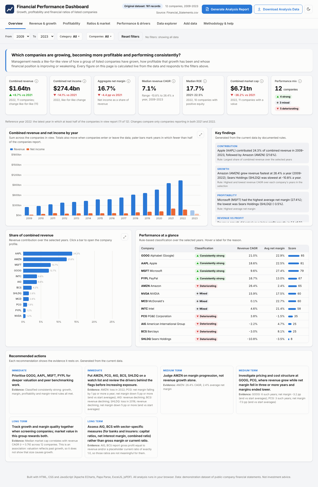
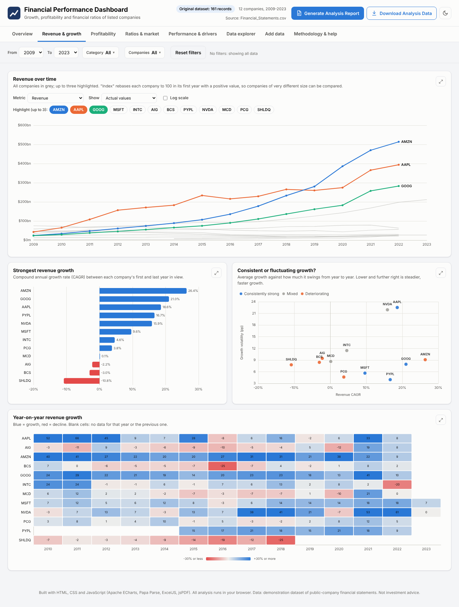
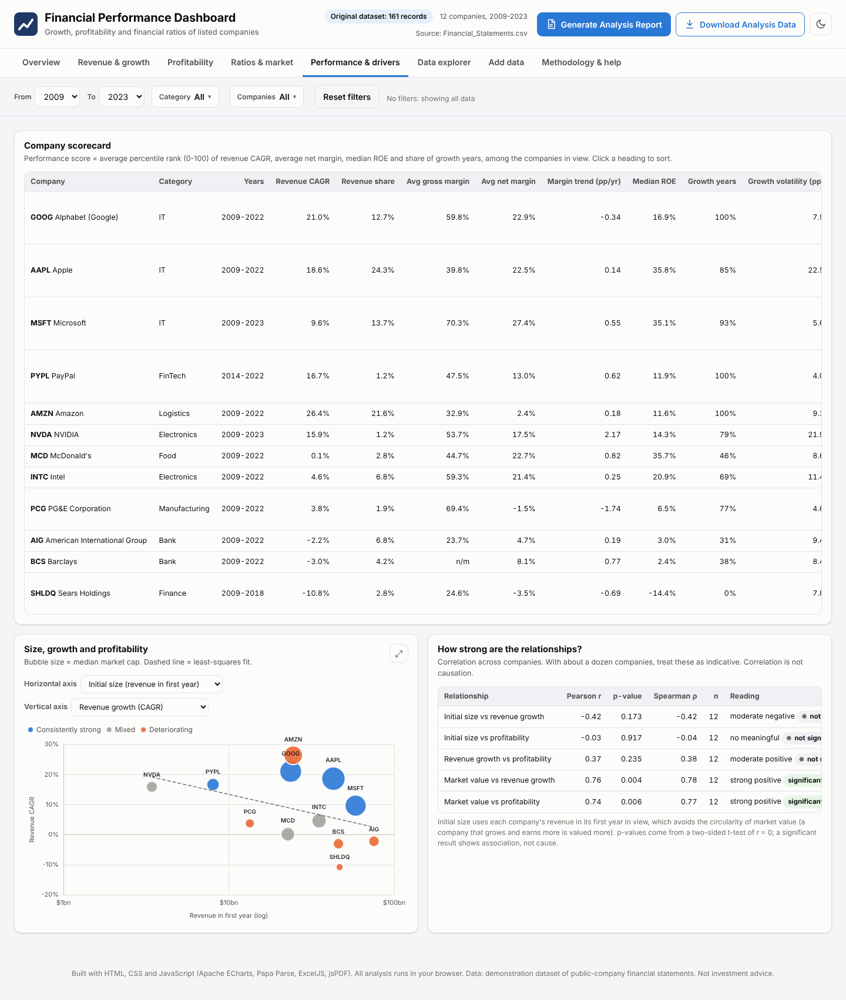
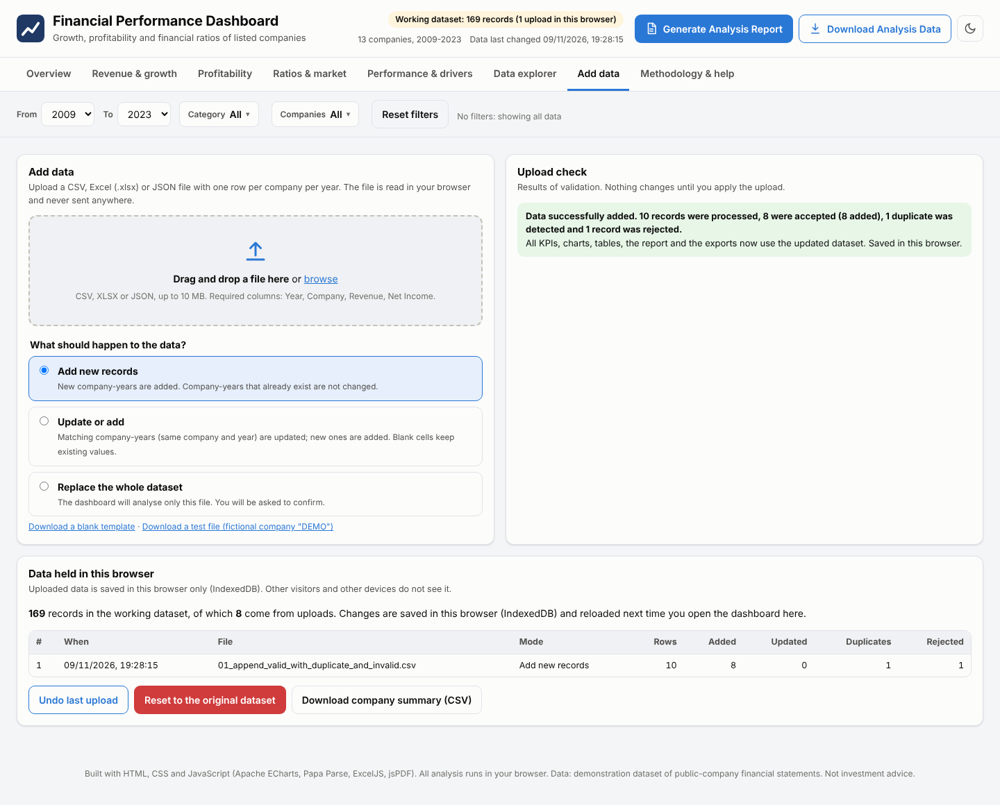
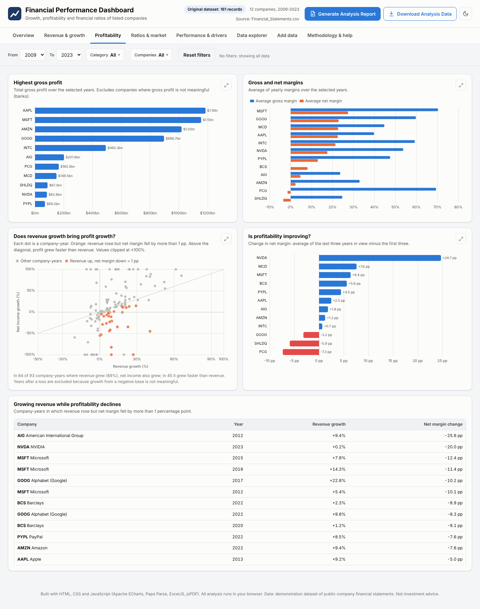
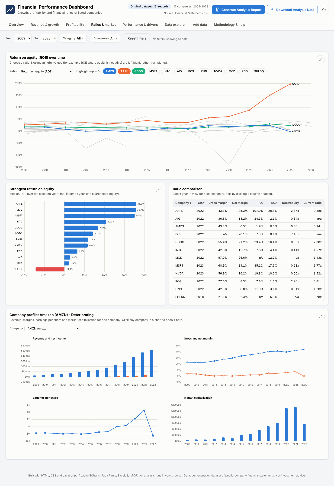
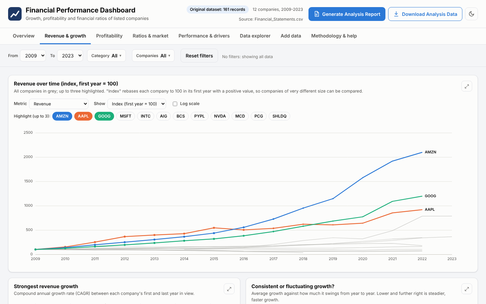
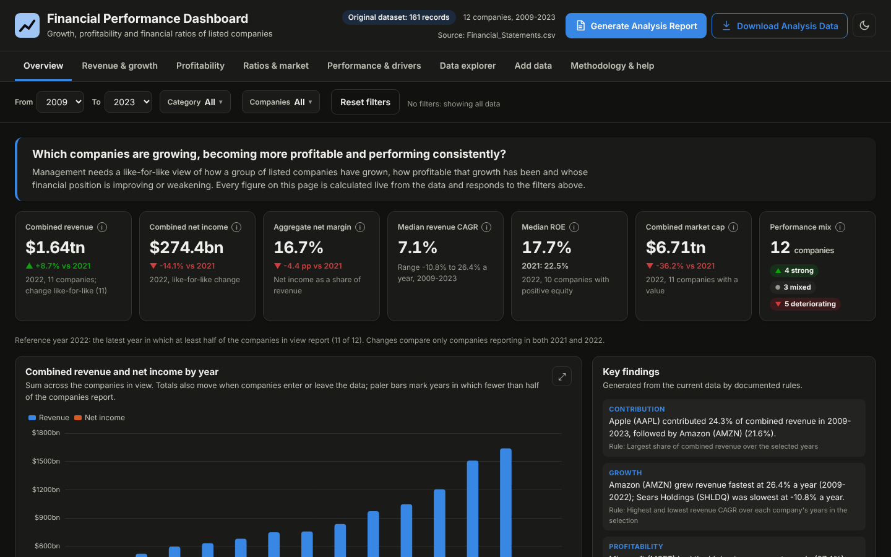
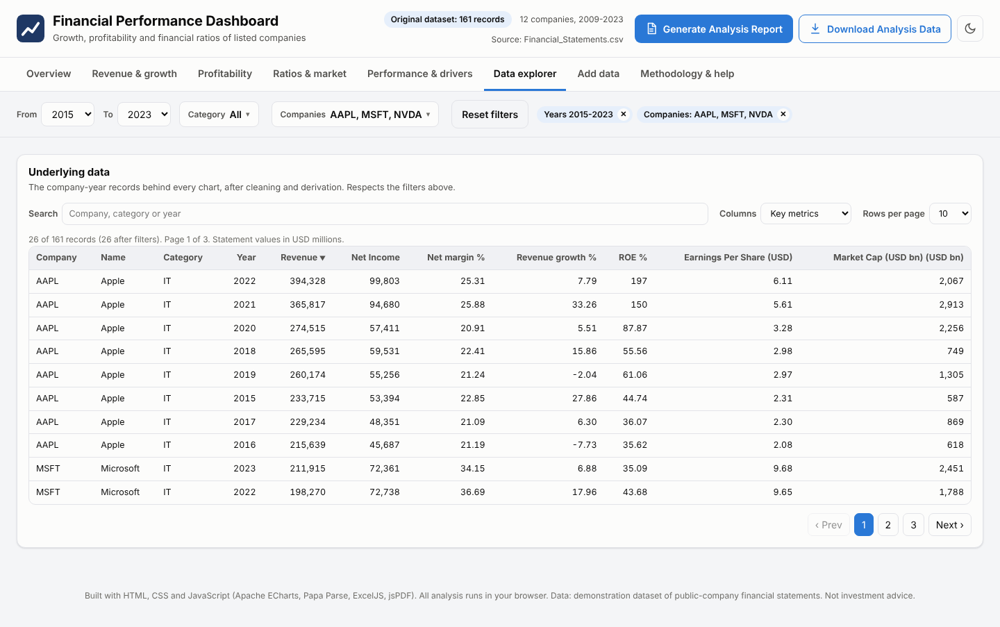
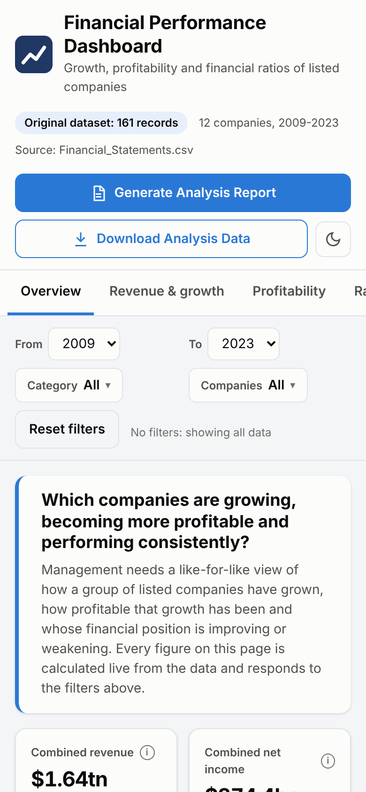

# Financial Performance Dashboard: Growth, Profitability and Financial Strength of Listed Companies

An interactive, browser-based analytics dashboard that compares 12 listed companies over up to 15 years:

- who is growing;
- who is becoming more profitable;
- how their financial position is changing;
- whose performance is consistently strong or deteriorating.

Every number is calculated live from the data. Users can add their own data, and the whole analysis, including a downloadable PDF report and data export, updates immediately.



## 1. Project overview

This is a financial performance analysis delivered as a working business intelligence tool. It reads company financial statements (income statement, balance sheet, cash flow and market data) and turns them into:

- like-for-like KPIs;
- growth and margin trends;
- ratio comparisons;
- a scorecard that classifies each company and explains why.

It runs entirely in the browser. It can be hosted free on GitHub Pages or opened straight from a folder.

## 2. Business scenario

A Financial Data Analyst has been asked to evaluate the financial performance of several publicly traded companies over multiple years. Management wants to understand:

- which companies are growing;
- which are becoming more profitable;
- how their financial positions are evolving;
- which demonstrate stronger financial performance.

## 3. Business problem

Headline revenue doesn't answer management's question. A company can grow quickly while its margins shrink. Another can be very profitable but barely growing. Large companies dominate totals simply because of their size.

The companies also differ in what can be compared: a bank has no cost of sales, and some firms have negative shareholder equity. Management needs a consistent, evidence-based comparison that respects these differences, and a tool it can keep using as new figures arrive.

## 4. Objectives

1. Evaluate revenue and profit trends across selected companies.
2. Compare profitability across companies and financial periods.
3. Examine the evolution of selected financial ratios.
4. Identify companies with consistently strong or deteriorating performance.
5. Assess relationships between company size, revenue growth and profitability.
6. Develop an executive financial performance dashboard.

## 5. Tools and technologies

| Tool | Version | Used for |
|---|---|---|
| HTML5, CSS3, JavaScript (no framework) | - | Application structure, design system (light and dark), all data processing and analytics |
| [Apache ECharts](https://echarts.apache.org/) | 6.1.0 | Charts |
| [Papa Parse](https://www.papaparse.com/) | 5.4.1 | Reading CSV files |
| [ExcelJS](https://github.com/exceljs/exceljs) | 4.4.0 | Reading and writing Excel files |
| [jsPDF](https://github.com/parallax/jsPDF) and jsPDF-AutoTable | 4.2.1 / 5.0.9 | Generating the PDF report in the browser |
| IndexedDB (built into browsers) | - | Saving uploaded data locally |
| Python (pandas, NumPy, SciPy) | - | Reference calculation used to verify the dashboard, and the processed CSV files |
| Playwright | - | Automated end-to-end tests |

The libraries are bundled in `assets/vendor/` with pinned versions, so the dashboard does not depend on external CDNs.

## 6. Dataset overview

- **Source:** `Financial_Statements.csv`, a public demonstration dataset of annual financial statement data for 12 listed companies, supplied for this project. Company names are added from the tickers for readability.
- **Scope:** 161 company-years, 2009-2023 (most companies 2009-2022). It has 23 fields: revenue, gross profit, net income, EPS, EBITDA, shareholder equity, three cash-flow lines, current ratio, debt/equity, reported ROE/ROA/ROI/net margin, free cash flow per share, return on tangible equity, employees, market capitalisation and US inflation.
- **Companies:** Apple, Microsoft, Alphabet, NVIDIA, Intel, Amazon, PayPal, McDonald's, PG&E, AIG, Barclays and Sears Holdings.
- **Units:** USD millions for statement values; USD billions for market capitalisation.
- **Important considerations:**
  - Coverage differs by company: Sears ends in 2018, PayPal starts in 2014, and Microsoft and NVIDIA include 2023.
  - Some ratios are not meaningful for some companies. Banks have no cost of sales, and McDonald's and Sears have negative equity in some years.
  - A few placeholder values were found and removed.

Full details: [data dictionary](data/data-dictionary.md).

## 7. Dashboard features

| Tab | What it answers |
|---|---|
| **Overview** | Seven KPI cards (with like-for-like changes and definitions), combined revenue and net income by year, revenue contribution, performance labels, rule-based key findings and recommended actions |
| **Revenue & growth** | A trend explorer for any metric (actual, indexed to 100, or log scale) with up to three highlighted companies, a revenue CAGR ranking, a growth-consistency scatter and a year-by-year growth heatmap |
| **Profitability** | Gross profit ranking, gross and net margins, revenue growth vs net income growth, margin change, and a table of years where revenue grew but margins fell |
| **Ratios & market** | ROE, ROA, margins, debt/equity, current ratio, EPS and market cap over time; ROE ranking; latest-year ratio table; one-company profile |
| **Performance & drivers** | Sortable scorecard with performance score and classification reasons; size vs growth vs profitability bubble chart with correlation statistics |
| **Data explorer** | Searchable, sortable, paginated table of every record and derived metric |
| **Add data** | Upload, validation, add, merge or replace, undo, reset |
| **Methodology & help** | How to use the dashboard, KPI definitions, cleaning rules, classification rules and the upload format |



## 8. How the dashboard works

```text
Base CSV (embedded) ─┐
                     ├─► validate & map columns ─► stored records ─► clean & derive ─► filters ─► analytics ─► KPIs, charts, tables,
Uploaded file ───────┘         (IndexedDB)                                                         findings, PDF report, exports
```

There is one data flow and nothing is pre-calculated. Any change runs the whole chain again: a filter, an upload, an undo or a reset. Every view, the report and the export therefore always use the same dataset.

## 9. Interactive functionality

- Year, category and company filters, with active-filter chips and a one-click reset.
- Hover tooltips with units on every chart. Click any company to drill into its profile.
- Trend controls: metric choice, indexed or log view, and a highlight for up to three companies.
- Full-screen view for every chart.
- Sortable tables, a searchable and paginated data explorer, and KPI definitions on the **i** buttons.
- Light and dark mode, keyboard-accessible tabs, and a layout that adapts to tablets and phones.



## 10. Additional data upload process

The **Add data** tab accepts CSV, Excel (.xlsx) and JSON files (up to 10 MB). After a file is chosen:

1. **Columns are matched** to the expected fields. Case, spaces and punctuation are ignored, and common alternatives are recognised (for example "Ticker" for Company, "Total Revenue" for Revenue). The mapping is shown to the user, and unrecognised columns are reported and ignored.
2. **Files missing a required column** (Year, Company, Revenue, Net Income) **are rejected** with an explanation.
3. **Every row is validated:**
   - a 4-digit year;
   - a valid ticker;
   - numeric values (accepting "1,234", "$5" and "(12)" as -12);
   - revenue above zero.
   Optional fields that are not numbers are stored as missing, with a warning.
4. **Duplicates are detected**, both inside the file and against existing data, using the business key **company + year**.
5. **A preview** shows:
   - rows read;
   - rows accepted and rejected;
   - duplicates;
   - records to add or update;
   - the reason for every row that will not be used.
   Results can be downloaded as CSV. Nothing changes until the user presses **Apply**.
6. **Three modes:**
   - **Add new records** never changes existing data.
   - **Update or add** overwrites matching company-years; blank cells keep their old values.
   - **Replace the whole dataset** asks for confirmation first.



## 11. Automatic refresh and data persistence

After an upload is applied, the dashboard recalculates every KPI, chart, table, filter option, date range, finding and recommendation. The PDF report and exports use the new data too, and no page reload is needed. A confirmation states the actual counts, for example: *"Data successfully added. 10 records were processed, 8 were accepted (8 added), 1 duplicate was detected and 1 record was rejected."*

**Where data is kept:**

- The working dataset is saved in the browser's IndexedDB and reloads the next time the page is opened in the same browser.
- **It is local to that browser and device. It is not uploaded anywhere and other visitors never see it.**
- **Undo last upload** steps back one upload at a time. **Reset to the original dataset** clears local storage.

Sharing updates between users would need a backend: a database, an API and user authentication.

## 12. Analysis performed

- **Growth.** CAGR per company, year-on-year growth between consecutive years, the share of years with growth, and growth volatility.
- **Profitability.**
  - Gross, net and EBITDA margins recalculated from the statements.
  - Median ROE, with companies whose equity is negative excluded.
  - Margin trend (least-squares slope) and margin shift (average of the last three years vs the first three).
- **Revenue vs profit.** How often revenue growth came with net income growth, and the company-years where revenue grew while margins fell by more than 1 pp.
- **Like-for-like KPIs.** The reference year is the latest year in which at least half of the companies report. Changes compare only companies present in both years.
- **Classification.** Each company is labelled Consistently strong, Mixed or Deteriorating using documented rules, and the reason is shown. A relative performance score (0-100) ranks the companies.
- **Relationships.** Pearson and Spearman correlations with p-values between size, growth and profitability, using two measures of size.

Details: [methodology](documentation/methodology.md).

## 13. Key findings (original dataset, 2009-2023)

- **Four companies are consistently strong.** Alphabet, Apple, Microsoft and PayPal combine at least 5% annual revenue growth, average net margins of at least 10%, profit in almost every year and stable or rising margins.
- **Five are flagged as deteriorating, for different reasons:**
  - Amazon made a loss in 2022, despite the fastest growth (26.4% a year) and the thinnest margins (2.4% on average).
  - PG&E's margins fell by 7.3 pp.
  - AIG's and Barclays' revenue declined.
  - Sears declined until it left the data in 2018.
- **Growth did not always bring profit.** In only 69% of company-years with higher revenue did net income also rise. In 2022, combined revenue grew 8.7% like-for-like while combined net income fell 14.1% and the aggregate net margin dropped 4.4 pp.
- **Revenue is concentrated.** Apple (24.3%) and Amazon (21.6%) produced almost half of all revenue in the data. Microsoft had the highest average net margin (27.4%). Apple, McDonald's and Microsoft had the highest median ROE (about 35-36%). Apple's ROE is lifted by a shrinking equity base (197% in 2022), and McDonald's is measured only in its years of positive equity.
- **Profitability improved most at NVIDIA** (+24.7 pp net margin, end vs start), followed by McDonald's (+7.6 pp).
- **Size and performance.** Initial size does not predict faster growth: smaller companies tended to grow faster (r = -0.42), but this is not statistically significant across 12 companies. Market value is strongly associated with growth and margins (r = 0.76 and 0.74, both p < 0.01). That reflects the market rewarding performance, not size causing it.

## 14. Business recommendations

| When | Recommendation | Evidence |
|---|---|---|
| Now | Prioritise Alphabet, Apple, Microsoft and PayPal for deeper valuation and peer benchmarking | Meet every "consistently strong" rule |
| Now | Put Amazon, PG&E, AIG, Barclays and Sears on a watch list and review what triggered each flag | Loss in latest year, falling margins or declining revenue |
| Medium term | Judge Amazon on margin progression, not revenue growth alone | 26.4% growth, but a 2.4% average net margin |
| Medium term | Investigate pricing and cost structure at Alphabet and PG&E | Revenue grew while net margin fell in 6 and 3 years respectively, ending lower |
| Long term | Screen on growth and margin quality together | Both are strongly associated with market value in this group |
| Long term | Assess AIG and Barclays with sector-specific measures (capital ratios, net interest margin) | Gross margin and current ratio are not meaningful for them in this data |

These recommendations are generated from the current data inside the dashboard, so they change with filters and uploads.

## 15. Screenshots

| | |
|---|---|
|  |  |
|  |  |
|  |  |

All screenshots were captured automatically from the running dashboard by the test suite.

## 16. How to run the dashboard locally

- **Simplest:** download or clone the repository and double-click `index.html`. Everything, including the data, is bundled.
- **With a local web server** (the same way GitHub Pages serves it):
  ```bash
  python -m http.server 8000
  # then open http://localhost:8000
  ```

## 17. How to deploy with GitHub Pages

1. Push the repository to GitHub, with `index.html` in the repository root.
2. Go to **Settings → Pages**. Under **Build and deployment**, choose **Deploy from a branch**, then select `main` and `/ (root)`. Save.
3. After a minute the dashboard is live at `https://<your-username>.github.io/<repository-name>/`.

No build step is needed. All paths are relative and no server code is used. The `.nojekyll` file stops GitHub from processing the files.

## 18. Using the report download button

1. Click **Generate Analysis Report**.
2. Choose **Current filtered view** or **Entire available dataset**.
3. Click **Generate PDF**.

The report is built at that moment from the data in the dashboard, including any uploads. It typically runs to 5-7 pages and covers:

- scope;
- business context;
- objectives;
- dataset;
- data preparation;
- methods;
- KPI definitions;
- results, with charts and the scorecard;
- correlations;
- key findings;
- interpretation;
- recommendations;
- limitations.

An example generated from the original data is in [`documentation/sample-generated-report.pdf`](documentation/sample-generated-report.pdf).

## 19. Downloading the analysis data

Click **Download Analysis Data**, then choose:

- **Full analysis dataset** or **Currently filtered dataset**;
- **CSV** or **Excel**.

The file contains the cleaned records actually being analysed, including uploads, with every derived metric and a `record_source` column. The file name states the scope. The Excel version adds a company-summary sheet and an "About" sheet recording the filters and dataset status. Text cells are protected against spreadsheet formula injection.

## 20. Repository structure

```text
├── index.html                  dashboard entry point
├── assets/
│   ├── css/styles.css          design tokens (light/dark), layout, components
│   ├── js/                     config, utils, data-processing, analytics, store (IndexedDB), charts,
│   │                           data-export, report-generator, app
│   ├── vendor/                 pinned third-party libraries (see VERSIONS.txt)
│   └── images/                 screenshots
├── data/
│   ├── raw/Financial_Statements.csv        original data (unchanged)
│   ├── base-data.js                        the raw CSV embedded for offline use
│   ├── processed/                          cleaned and analysis-ready CSVs, company summary, cleaning log
│   └── data-dictionary.md
├── documentation/              technical report (DOCX/PDF), methodology, limitations, user guide,
│                               portfolio positioning, sample generated report
├── scripts/                    Python: prepare_data.py (reference pipeline), build_base_data.py
└── tests/                      Playwright tests, upload test files, test report, Python cross-checks
```

## 21. Limitations

- There are only 12 companies, chosen by the dataset author and from very different sectors, with uneven year coverage. The findings describe this group only.
- Correlations across 12 companies are indicative, and correlation is not causation.
- Classification thresholds and the performance score are documented conventions. Changing the companies in view can change the labels.
- Total assets, debt and segment data are missing, so ROA is used as reported. Banks, insurers and companies with negative equity can't be compared on every ratio.
- Uploaded data is validated for structure, not factual accuracy. It is stored only in the user's browser.
- Automated tests ran in Chromium. An actual GitHub Pages publish was not performed from the build environment, although all of its requirements were checked.

More: [limitations](documentation/limitations.md) · [test report](tests/test-report.md).

## 22. Data source and disclaimer

The dataset (`Financial_Statements.csv`) was supplied for this project as a public demonstration dataset of annual financial-statement figures for listed companies. Figures are presented as they appear in that file, apart from the documented cleaning rules. They have not been reconciled with company filings, so they may contain errors or differ from official reports. The upload test files in `tests/data/` use fictional companies with invented figures. **This project is an analytical demonstration, not investment advice.**

## 23. Conclusion

The project turns a raw table of financial statements into a decision tool that management can use and keep using. It shows which companies combine growth with profitability, where growth has come at the expense of margins, and which companies need a closer look. Every result traces back to a documented rule. New data flows through the same validated pipeline, and the figures are verified against an independent calculation and 108 automated checks.
